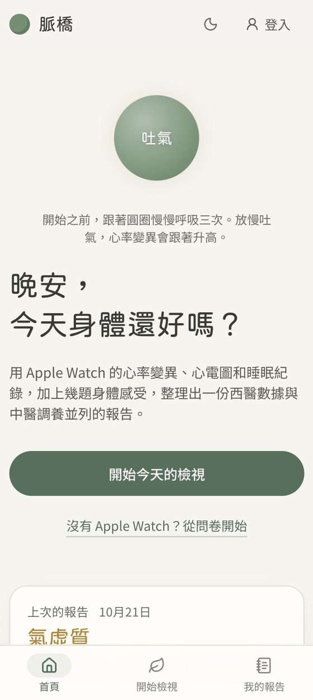
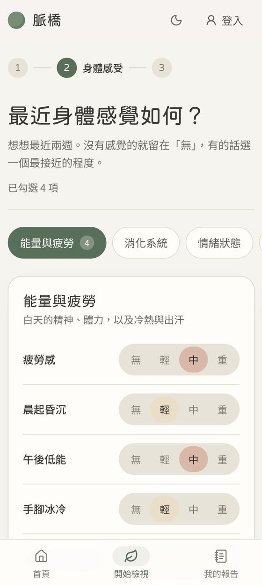
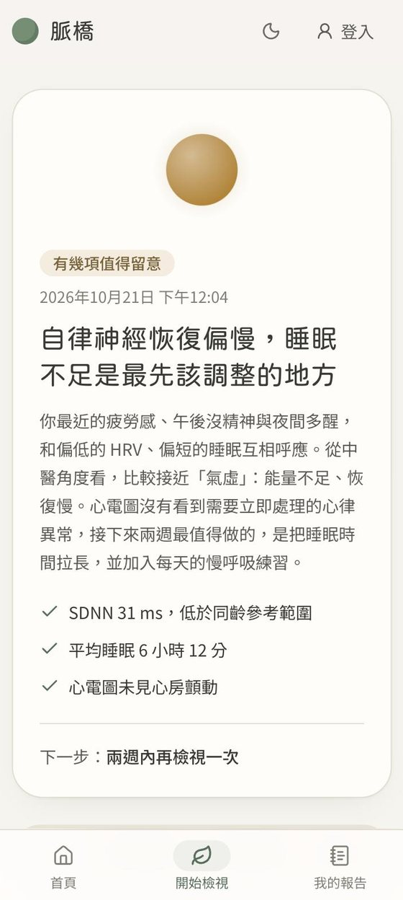
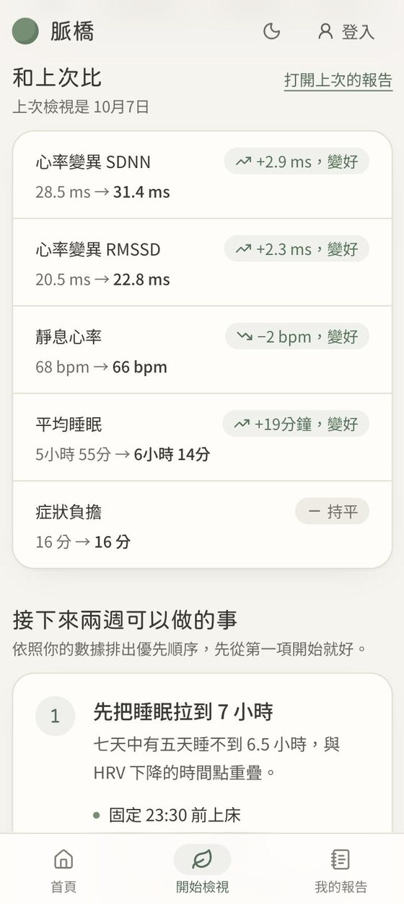
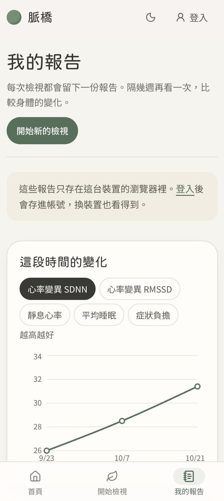
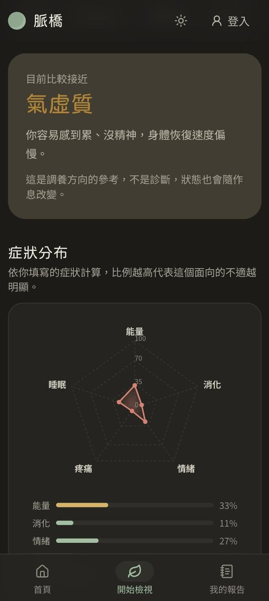
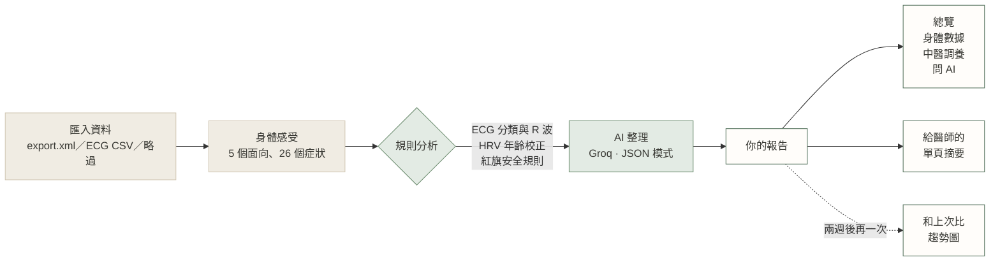
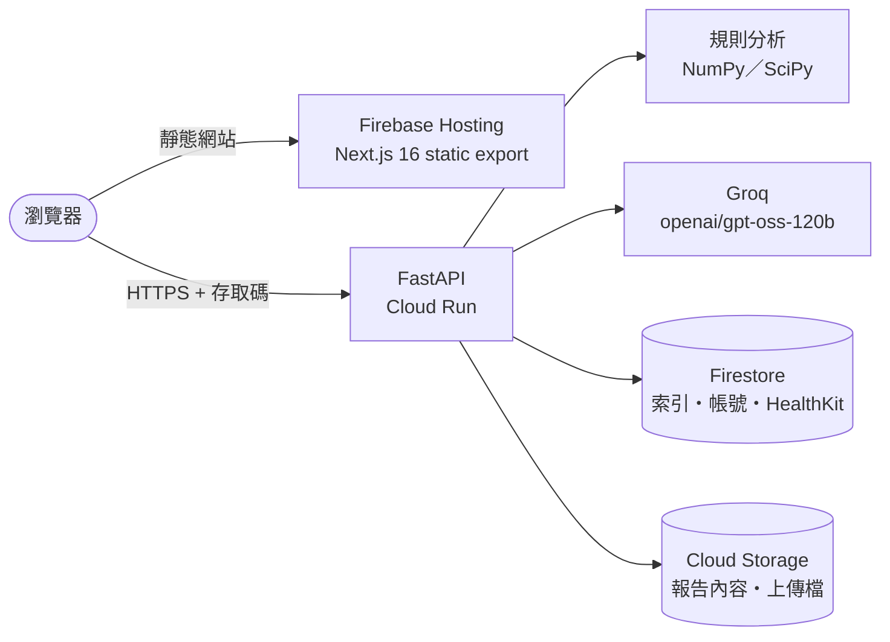

<p align="center">
  <picture>
    <source media="(prefers-color-scheme: dark)" srcset="docs/assets/banner-dark.svg">
    
  </picture>
</p>

<p align="center">
  <a href="https://pulse-ai-d54fb.web.app"></a>
  <a href="https://github.com/wenglien/PulseBridge/actions/workflows/ci.yml"></a>
  
  
  
  <a href="LICENSE"></a>
</p>

<p align="center">
  <a href="https://pulse-ai-d54fb.web.app"><b>線上試用</b></a>
  &nbsp;&nbsp;|&nbsp;&nbsp;
  <a href="#本機開發">本機開發</a>
  &nbsp;&nbsp;|&nbsp;&nbsp;
  <a href="docs/deploy-cloud-run.md">部署指南</a>
  &nbsp;&nbsp;|&nbsp;&nbsp;
  <a href="#隱私設計">隱私設計</a>
</p>

**脈橋**把 Apple Watch 的心電圖、心率變異（HRV）與睡眠紀錄，加上你最近兩週的身體感受，整理成一份**西醫數據與中醫調養並列**的報告：哪些指標偏離、代表什麼、接下來兩週先做哪一件事。看不懂的地方可以直接追問，要看醫生時，一鍵印出給醫師的單頁摘要。

> **In English** — PulseBridge turns Apple Watch ECG, HRV and sleep data plus a short symptom check-in into one report that reads the same heartbeat two ways: Western biomarkers against age-adjusted references, and Traditional Chinese Medicine guidance on how to adjust. Rule-based safety checks run before the LLM ever sees the data; each report is visible only to whoever holds its access token.

<br>

<table>
  <tr>
    <td align="center" width="33%"><br><sub><b>開始之前，先呼吸三次</b><br>放慢吐氣會提高 HRV，首頁的圓就是一個小練習</sub></td>
    <td align="center" width="33%"><br><sub><b>身體感受</b><br>每個症狀明確選「無／輕／中／重」</sub></td>
    <td align="center" width="33%"><br><sub><b>一眼看懂的摘要</b><br>圓的顏色代表整體狀態，最後一行是下一步</sub></td>
  </tr>
  <tr>
    <td align="center"><br><sub><b>和上次比</b><br>HRV、靜息心率、睡眠、症狀，各自標出變好或變差</sub></td>
    <td align="center"><br><sub><b>這段時間的變化</b><br>每次檢視都會留下一個點</sub></td>
    <td align="center"><br><sub><b>中醫調養（深色模式）</b><br>體質傾向只當調養方向，不當標籤</sub></td>
  </tr>
</table>

<sub>截圖使用專案內建的示範資料，不含任何真實個人資料。</sub>

---

## 它能做什麼

<table>
  <tr>
    <td valign="top" width="50%">

**西醫看數據**

- **心電圖**：竇性心律、心房顫動、無法判讀等分類統計，並從原始波形偵測 R 波、推算心率
- **心率變異**：SDNN、RMSSD、pNN50、LF/HF，和**同年齡參考範圍**比較（範圍條與文字使用同一組年齡校正值）
- **睡眠**：深睡、REM、核心睡眠比例與睡眠效率
- **安全規則先行**：例如「中度以上胸悶＋心房顫動」會在 AI 之前就被標成**立即就醫**，不依賴模型判斷

</td>
    <td valign="top" width="50%">

**中醫看狀態**

- **身體狀態**：依問卷與生理數據判斷較接近的體質傾向（如氣虛、陰虛），明確標示「調養參考，不是診斷」
- **調養建議**：飲食、作息、運動、穴位、情緒，依優先順序排列，可依類別篩選
- **症狀分布**：五大面向的雷達圖
- **每條建議附出處**：以作者與年份標示，點一下就能看到完整文獻

</td>
  </tr>
  <tr>
    <td valign="top">

**跟著你一段時間**

- **和上次比**：自動找出上一次檢視，逐項比較
- **趨勢圖**：在「我的報告」看每次檢視的變化
- **問 AI**：AI 已讀過整份報告，可以問數字的意思或建議怎麼開始
- **給醫師的摘要**：A4 單頁，就醫重點、量測值與參考範圍、自述症狀一目了然

</td>
    <td valign="top">

**三種開始方式**

- **完整匯出檔**：iPhone「健康」App 的 `export.xml`，在瀏覽器先 gzip 再上傳，伺服器以串流方式只讀取選定期間
- **只有心電圖 CSV**：一次選多個檔，或直接拖進匯出檔裡的 `electrocardiograms/` 資料夾（中英文介面的匯出格式都支援）
- **只填問卷**：沒有 Apple Watch 也能用；也可以先用內建範例資料試試看

</td>
  </tr>
</table>

---

## 一次檢視怎麼進行



確定性的部分（心電圖分類、HRV 計算與年齡參考、紅旗規則、體質評分）都由程式完成，AI 只負責把這些結果整理成看得懂的文字與建議；使用者自由輸入的備註會先去除標記、放進獨立區塊，避免被當成指令。

---

## 隱私設計

健康資料只屬於產生它的人。

- **每份報告一組存取碼**：建立時隨機產生，伺服器只存雜湊值；讀取、修改、刪除、產生報告與追問都必須帶上（`X-Session-Token`），或由已登入的擁有者操作。
- **不存在與沒權限看起來一樣**：兩者都回傳相同的 404，無法用編號去試探；報告編號含 64 位元隨機值，且只能由伺服器產生。
- **沒有「列出所有人」的 API**：「我的報告」只會查詢這個瀏覽器持有存取碼的報告；登入後才會把報告歸到帳號，讓其他裝置也看得到。
- **列印摘要不執行任何程式**：所有內容都經過 HTML 跳脫，頁面的 CSP 禁止腳本。
- **保護措施**：分析、追問、上傳、登入都有頻率限制；部署環境若沒有設定足夠強的 `JWT_SECRET` 會拒絕啟動。

---

## 架構



| | 使用的技術 |
|---|---|
| **前端** | Next.js 16（App Router、static export）、React 19、TypeScript、Tailwind CSS v4、Recharts、Radix UI |
| **後端** | FastAPI、Pydantic v2、NumPy／SciPy（HRV 頻域分析）、httpx（非同步 LLM 呼叫） |
| **儲存** | 雲端：Firestore 存索引與帳號，Cloud Storage 存報告內容與上傳檔（心電圖波形會超過 Firestore 1 MiB 上限）。本機：SQLAlchemy＋SQLite，兩者實作同一套介面 |
| **AI** | Groq，預設 `openai/gpt-oss-120b`（JSON 模式）；相容任何 OpenAI 格式的端點 |
| **設計** | 米色與鼠尾草綠配色、jf open 粉圓標題、Noto Sans TC 內文，支援深色模式 |

---

## 本機開發

**需要**：Python 3.11 以上、Node.js 20、一組 [Groq API key](https://console.groq.com)（有免費額度）。

```bash
git clone https://github.com/wenglien/PulseBridge.git
cd PulseBridge
```

**後端**（預設使用 SQLite，不需要任何雲端帳號）

```bash
cd backend
python -m venv venv && source venv/bin/activate     # Windows：venv\Scripts\activate
pip install -r requirements-dev.txt
cp .env.example .env                                # 至少填入 GROQ_API_KEY
uvicorn main:app --reload --port 8000               # API 文件：http://localhost:8000/docs
```

**前端**

```bash
cd frontend
npm install
cp .env.example .env.local                          # 預設 NEXT_PUBLIC_API_URL=http://localhost:8000
npm run dev                                         # http://localhost:3000
```

沒有自己的匯出檔？在上傳頁按「**用範例資料試試看**」。

<details>
<summary><b>環境變數</b></summary>

**後端 `backend/.env`**

| 變數 | 必填 | 說明 |
|---|---|---|
| `GROQ_API_KEY` | 是 | Groq API key |
| `JWT_SECRET` | 部署時 | 簽發登入 token 的密鑰，至少 32 字元：`python -c "import secrets; print(secrets.token_hex(32))"` |
| `GROQ_MODEL` | | 預設 `openai/gpt-oss-120b` |
| `STORAGE_BACKEND` | | `sql`（預設，本機）或 `firestore`（Cloud Run） |
| `DATABASE_URL` | | 僅 `sql`：資料庫連線字串，留空為 SQLite |
| `GCP_PROJECT`、`GCS_BUCKET` | `firestore` 時 | GCP 專案與存放報告內容的私有 bucket |
| `FIRESTORE_DATABASE`、`FIRESTORE_PREFIX` | | 非預設資料庫；以前綴隔離 staging 資料 |
| `CORS_ORIGINS`、`CORS_ORIGIN_REGEX` | | 允許的前端網域 |
| `DATA_DIR` | | 本機資料與上傳暫存目錄，預設 `./data` |
| `MAX_XML_SIZE_MB`、`MAX_CSV_FILE_SIZE_MB` | | 上傳大小上限 |
| `RATE_LIMIT_ENABLED`、`FORWARDED_IP_HOPS` | | 頻率限制開關；Cloud Run 上維持 `1` |

**前端 `frontend/.env.local`**

| 變數 | 說明 |
|---|---|
| `NEXT_PUBLIC_API_URL` | 後端網址（不含結尾斜線） |
| `NEXT_PUBLIC_FIREBASE_*` | 選填，僅 Firebase Analytics 使用 |

</details>

<details>
<summary><b>專案結構</b></summary>

```
PulseBridge/
├── backend/
│   ├── api/
│   │   ├── routes/            analysis（報告串流、追問）、health_data（XML／CSV／ECG）、
│   │   │                      questionnaire、sessions（查詢、歸屬、刪除）、auth、healthkit
│   │   ├── dependencies.py    存取碼驗證
│   │   └── auth_deps.py       登入（JWT）
│   ├── core/
│   │   ├── pipeline.py        規則分析總入口（ECG、HRV、紅旗、體質）
│   │   ├── red_flags.py       需要立即就醫的組合
│   │   ├── ecg_analyzer.py    R 波偵測、心律分類、風險
│   │   ├── hrv_analyzer.py    SDNN／RMSSD／LF-HF（Welch）
│   │   ├── hrv_reference.py   同年齡參考範圍
│   │   ├── csv_parser.py      ECG／心率／HRV CSV（中英文原生格式與欄位格式）
│   │   ├── xml_stream_parser.py  串流解析 Apple Health XML
│   │   ├── claude_engine.py   提示詞組合與 LLM 呼叫
│   │   └── rate_limit.py
│   ├── db/store/              儲存介面：sql.py（本機）、firestore.py（雲端）
│   ├── scripts/               purge_legacy_sessions.py
│   └── tests/                 115 個測試，權限測試在兩種儲存後端各跑一次
├── frontend/
│   ├── app/                   首頁、upload、questionnaire、analysis、history、account
│   ├── components/
│   │   ├── flow/              三步驟進度
│   │   ├── analysis/          報告、比較、追問、引用
│   │   ├── charts/            HRV、心電圖、睡眠、趨勢
│   │   ├── upload/            匯出檔與心電圖 CSV 選擇器
│   │   └── ui/                呼吸圓、按鈕、卡片
│   └── lib/                   api、sessionVault（存取碼）、auth、reportPrint（醫師摘要）
└── docs/
    ├── deploy-cloud-run.md    Cloud Run＋Firestore＋Cloud Storage 部署步驟
    └── assets/                README 圖片
```

</details>

---

## 支援的資料

| 來源 | 內容 |
|---|---|
| **Apple Health 匯出檔** `export.xml` | 心率、靜息心率、HRV（SDNN 與逐拍資料）、睡眠分期、呼吸速率、血氧、手腕溫度、VO₂ Max |
| **心電圖 CSV** `electrocardiograms/*.csv` | Apple Watch 原生匯出（中文或英文介面），含 512 Hz 原始波形；也支援 Health Auto Export 等欄位格式 |
| **症狀問卷** | 能量、消化、情緒、疼痛、睡眠，共 26 個症狀與自由備註 |

同一份報告最多保留 500 筆心電圖；最新 30 筆保留原始波形供分析，較舊的會先從波形算出心率再保存，避免報告過大。

---

## 測試與部署

```bash
cd backend && python -m pytest            # 115 個測試
cd frontend && npm run lint && npx tsc --noEmit && npm run build
```

每次 push 與 pull request 都會由 [GitHub Actions](.github/workflows/ci.yml) 跑以上檢查。正式環境的建置步驟（Firestore、私有 bucket、Secret Manager、服務帳號權限）請見 **[docs/deploy-cloud-run.md](docs/deploy-cloud-run.md)**。前後端需要一起部署，因為後端要求存取碼，而舊版前端不會傳送。

---

## 限制與免責聲明

- **這不是醫療器材。** 所有內容僅供健康資訊參考，不能取代醫師診斷；出現胸痛、昏厥、呼吸困難等症狀，請直接就醫或撥打 119。
- Apple Watch 是**單導程**心電圖，無法排除所有心律不整。
- 中醫體質評分以規則為基礎，只作為調養方向參考，不能取代合格中醫師的辨證。
- 資料越少，判讀的可信度越低；報告會明確標示資料不足的地方。

---

## 授權

[MIT](LICENSE)
